# Abismo Sombrio

Uma nova dimensão escura e perigosa: ilhas flutuantes sobre um mar de trevas, portal de Netherite, mobs de terror, o Cavaleiro Sombrio, masmorras com os melhores baús do servidor, 7 minérios novos e o traje mágico SpectreBound.

<!-- oculta -->
<!-- capa: midia/abismo/capa.png -->
<!-- busca: abismo, dimensao, ritual, rituais, altar, invasao, estagios, ilhas flutuantes, floresta palida, vale dos ossos, jardim de cristal, trevas profundas, mar de trevas, portal, coracao, cavaleiro, sombrio, chefe, boss, terror, masmorra, cripta, santuario, torre, minerios, cristal do eco, alma errante, hematita, sol negro, onix sombrio, rosa abissal, abissita, spectrebound, traje, essencia, sanidade, mare sombria, lanterna, tonico, selo, forjaabismo -->

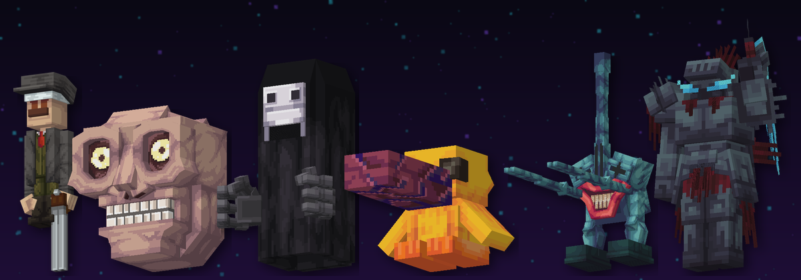

## O que é o Abismo

O Abismo **não é caverna**. É um **vão gigante** e escuro, sem céu:

- **ilhas flutuantes** em várias alturas, ligadas por nada (leve blocos para atravessar);
- **pilares colossais** do chão até o teto;
- pontas de pedra e **correntes com lanternas de alma** penduradas no teto;
- lá embaixo, o **Mar de Trevas**: água negra com colunas de obsidiana. Lá dentro você não enxerga e a sanidade despenca.

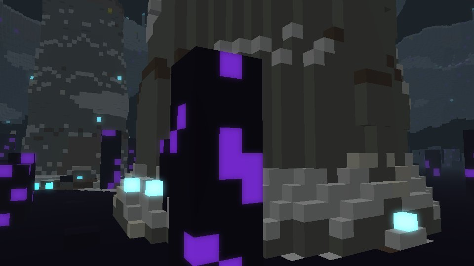

### As 4 regiões

Cada região tem bioma próprio: cor da névoa, partículas no ar e sons. Nada lembra o Nether.

::: lado
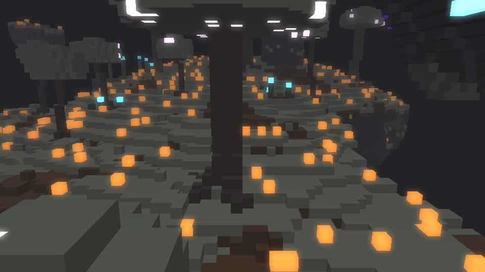
**Floresta Pálida**: musgo pálido, carvalhos pálidos gigantes, musgo pendurado e olhos-flor brilhando no escuro. Silêncio total.
+++
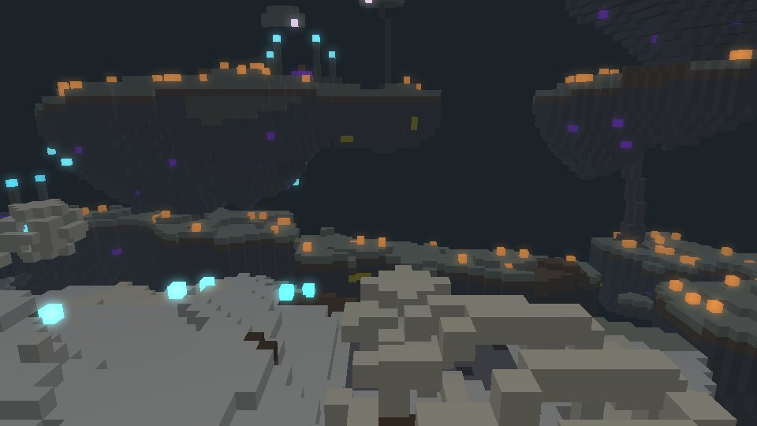
**Vale dos Ossos**: calcita, fósseis gigantes, crânios, fogo azul e sussurros de almas.
:::

::: lado
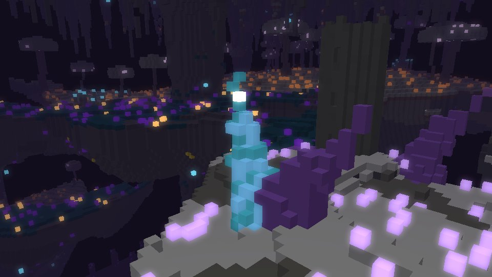
**Jardim de Cristal**: espinhos enormes de ametista (roxos) e de cristal azul com luz por dentro (ciano).
+++
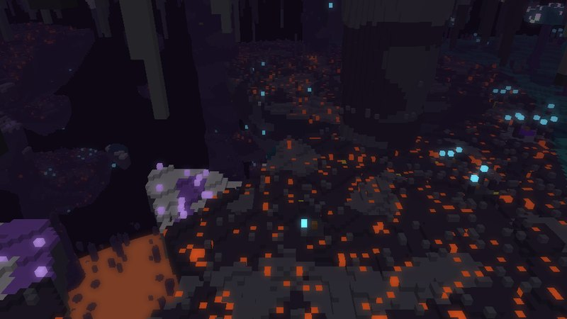
**Trevas Profundas**: quase preto. Sculk, obsidiana, poças de trevas e velas pretas acesas.
:::

> Dica: as imagens são uma prévia do gerador do mundo, sem as texturas do jogo.

É o lugar **mais perigoso** do servidor:

- **PvP ligado**.
- **Morreu, perdeu os itens.**
- **Não dá para marcar casa** (`/sethome`) nem usar cama. Para sair, use o portal de volta ou `/home`.
- Só se entra **pelo portal**: `/tpa`, `/warp` e `/back` não levam para dentro.

> Atenção: entre preparado. Leve comida, tochas, armadura boa e só o que você aceita perder.

## Coração do Abismo

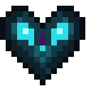 {15%}

A chave do Abismo. **Abrir o portal gasta 1 Coração.** Quando o primeiro jogador atravessa, o portal fica **aberto por 5 minutos** para todo mundo (os amigos entram de graça) e depois se fecha: para abrir de novo, outro Coração. A volta é sempre de graça.

Na bancada: **Sculk, Fragmento de Eco, Sculk / Eco, Olho do Ender, Eco / Sculk, Eco, Sculk**. Também aparece nos baús do Abismo.

## Montar o portal

::: lado
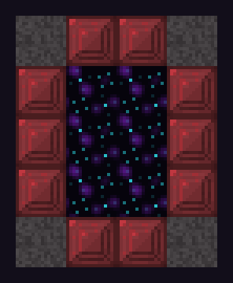 {70%}
+++
Moldura **em pé**, de **4 de largura por 5 de altura**:

- **Bloco de Netherite** nos **4 cantos**.
- **Bloco de Netherite Vermelho** nos **outros 10** blocos da borda.
- O meio fica vazio.

Clique na moldura com o **Coração do Abismo** na mão e o portal desperta, com um **véu negro** que se mexe.

O véu é igual no **Java e no Bedrock** (a mesma textura negra animada) e dá para atravessar andando nos dois.

Lá dentro aparece um portal de **Obsidiana Chorona**: é a volta, de graça.
:::

## Mobs de terror

No Abismo aparecem 5 criaturas de terror, além de **esqueletos wither**, **mobs radioativos** e **zumbis e esqueletos instáveis**, que explodem como creeper (sem quebrar blocos).

::: lado
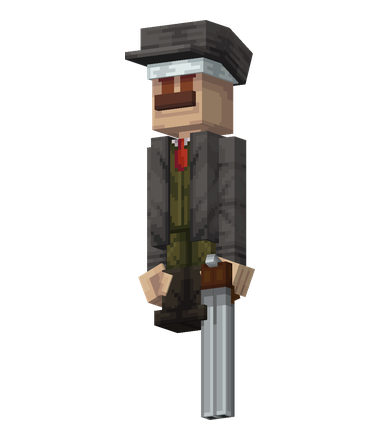
+++
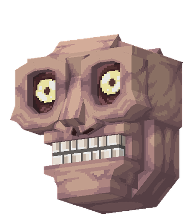
+++
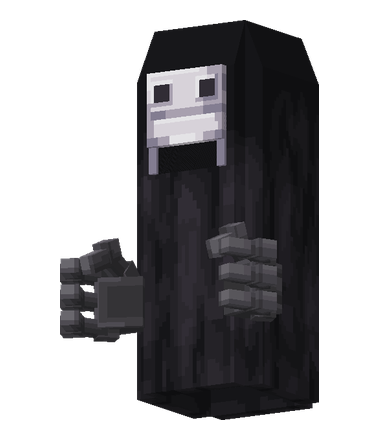
:::

::: lado
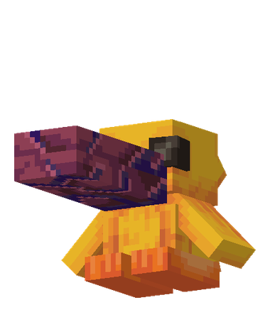
+++
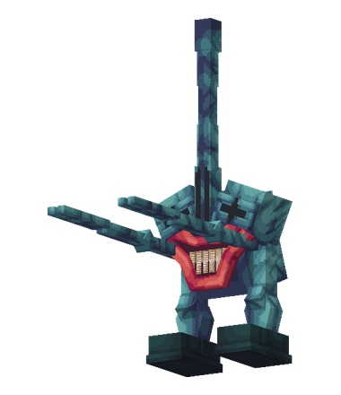
:::

Os 5 mobs de terror são **Míticos** na captura: só o **Orbe Divino** (ou o Orbe Mestre, de 15% a 25%) consegue pegar.

## ☠ Cavaleiro Sombrio

::: lado
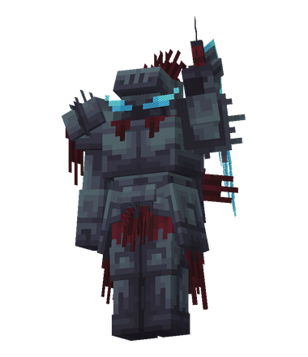 {80%}
+++
O chefe do Abismo, com **9.000 de vida**.

De tempos em tempos ele **desperta perto de alguém** que está no Abismo, e o chat mostra as coordenadas. Também dá para chamar com o **Selo do Cavaleiro**.

Golpes em área, corte que faz o chão tremer, estocada, giro e servos esqueletos. Com metade da vida ele fica **furioso** e escurece a visão de quem está perto.

É uma criatura **Deus**: só o **Orbe Divino** captura.
:::

## Masmorras e tesouros

Espalhadas pelo Abismo: **masmorras** (5 a 9 salas e uma sala do tesouro, escondidas dentro da rocha das ilhas, dos pilares e do teto), **criptas**, **santuários**, **torres** e **ruínas**, com geradores de monstros.

- Os geradores de monstros soltam **mobs fortes do Abismo** (Carrasco, Caçador, Predador, Esqueleto Wither do Abismo...), com mais força e resistência. No máximo 6 por gerador.
- Às vezes um gerador **acorda um Warden** (no máximo 1 por perto). A Visão Abissal protege da Escuridão dele.
- Os baús têm **o melhor loot do servidor**, com itens Astral.
- O loot é **só seu**: cada jogador abre o próprio.
- A sua **patente (Rank)** aumenta o que vem.
- Os baús **enchem de novo** sozinhos (tesouros e santuários demoram mais).

## Rituais do Abismo

::: lado
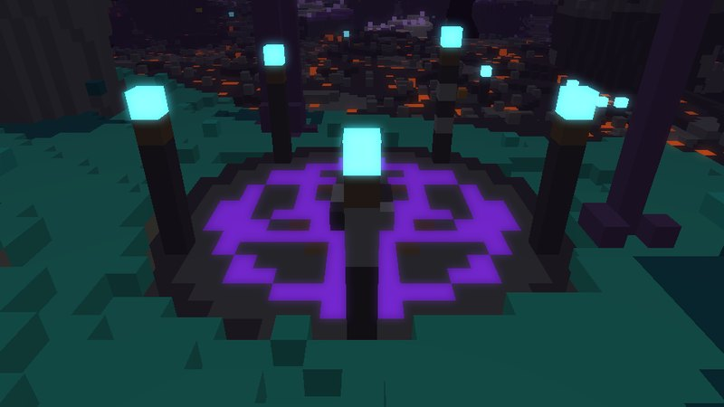
+++
Pelo Abismo existem **círculos de ritual**: estrela de obsidiana chorona, 5 obeliscos com fogo azul e um **altar de pedra-ímã** no meio.

Clique no altar com **qualquer Essência do Abismo** (gasta 1) e começa uma **invasão de 10 estágios**, cada um mais forte.
:::

- Os mobs do ritual **não soltam nada**. A recompensa vem no fim, e **quanto mais estágios vencer, melhor**.
- Quer parar? **Saia do círculo** (raio de 20 blocos): o ritual termina e paga pelos estágios que você venceu.
- **Mau Presságio:** beba um Frasco Sinistro e ative o altar com o efeito (nível I a V; o efeito é gasto). Cada nível traz **+30% de mobs**, e eles vêm mais fortes. Em troca, **+25% de blocos de prêmio por nível**; do nível III em diante todo baú sobe um nível, e o V dá ainda +2 blocos de Netherite.
- No fim, uma **espiral de almas** sobe do altar e faz aparecer no chão **blocos de ouro, esmeralda, diamante e netherite**, e **baús** com o loot do Abismo (o seu loot, com a sua patente).
- Os baús somem em **10 minutos**. O loot é **individual**: cada jogador que abre o baú recebe o seu.
- O altar descansa **20 minutos** depois de usado. Aí o círculo volta a ser como era: os prêmios que ninguém pegou somem.

| Estágios vencidos | Recompensa |
| --- | --- |
| 1 a 3 | blocos de ouro e esmeralda, baús de ruína |
| 4 a 6 | + blocos de diamante, baús de masmorra |
| 7 a 9 | + blocos de netherite, baús de santuário |
| 10 | 10 ouro, 6 esmeralda, 8 diamante, 3 netherite e 4 baús (2 de tesouro) |

## Minérios do Abismo

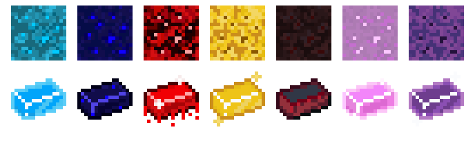

Sete minérios que **só existem no Abismo**, espalhados na escada de força do servidor:

| Minério | Força | Picareta | Tem |
| --- | --- | --- | --- |
| Cristal do Eco | entre Esmeralda e Diamante | Diamante | armadura e espada |
| Alma Errante | entre Diamante e Rubi | Diamante | armadura |
| Hematita | entre Rubi e Safira | Diamante | armadura e espada |
| Sol Negro | entre Safira e Netherite (perto do teto) | Diamante | armadura e espada |
| Ônix Sombrio | entre Titânio e Urânio | Netherite | armadura |
| Rosa Abissal | entre Urânio e Netherite Vermelho | Netherite | armadura e espada |
| **Abissita** | **acima do Netherite Vermelho** (perto do mar de trevas) | Netherite | armadura e espada |

Minério → **Bruto** → fornalha → **Lingote**. 9 lingotes = 1 bloco. Fortuna aumenta, Toque de Seda pega o minério. Com picareta fraca ele quebra devagar e não solta nada.

::: lado
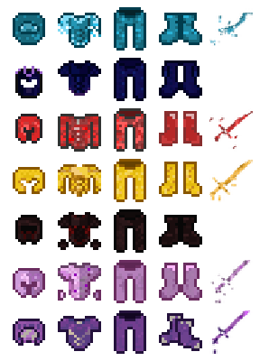 {80%}
+++
Armaduras e espadas: na **bancada** (formato normal) ou no `/forjaabismo`, que funciona igual no Java e no Bedrock.

Na bigorna elas só juntam com livro ou com a mesma peça.
:::

## Traje SpectreBound

::: lado
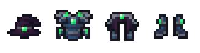
+++
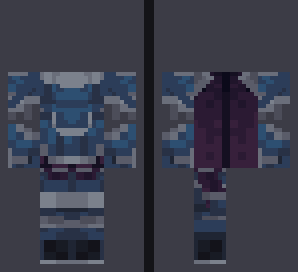 {70%}
:::

O traje mágico do Abismo. Defesa igual à do **Netherite Vermelho**.

Com as **4 peças** vestidas e a **Varinha Mágica** na mão:

- **+35%** de dano
- magias **40% mais baratas**
- a mana volta **2,5% por segundo** a mais
- **+150** de mana máxima

**Na bancada:** **Liga Abissal** + **Núcleo Espectral** + **Coração do Abismo**. Chapéu e botas: 2 Ligas. Peitoral: 4. Calça: 3. Sempre 1 Núcleo e 1 Coração.

O **Núcleo Espectral** é feito em 2 etapas: **Fragmento do Terror** + **Fragmento dos Mortos** (um em cima do outro na bancada).

Ou no `/forjaabismo`, direto com os lingotes, as essências e o Coração (mesmo custo).

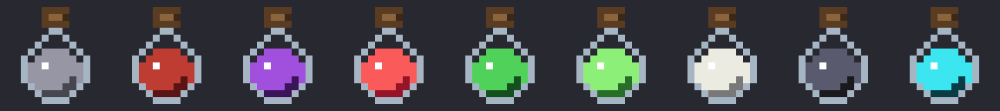

**Essências:** cada mob do Abismo solta a sua quando morto por jogador: Caçador, Carrasco, Encapuzado, Palhaço, Predador, Zumbi e Esqueleto Instável, Esqueleto Wither, Servo do Cavaleiro e Cavaleiro Sombrio (esse sempre solta).

## Lasers Abissais

De vez em quando uma **runa roxa acende no chão** perto de você: em 1 segundo um **feixe sai da terra** e fica 2 segundos. Quem estiver em cima toma dano a cada meio segundo, então **saia da runa**.

- Com a sanidade baixa os lasers aparecem mais.
- Nos rituais eles saem durante as ondas: um no pé de cada jogador e mais em volta do altar, mais ainda nos estágios altos e com Mau Presságio (que também aumenta o dano).

## Varinha Abissal

Uma varinha feita com o que há de mais raro no Abismo. **Clique direito mirando num jogador ou mob** (até 30 blocos): saem **3 lasers do Abismo** da terra no pé dele, um atrás do outro. Os lasers **seguem o alvo e acertam sempre** (3❤ cada).

- Gasta **40 de mana** (a mesma da Varinha Mágica) e recarrega em **12 segundos**.
- Receita na bancada (ou na /forjaabismo): **Liga Abissal** no cabo, **Núcleo Espectral** na ponta e **2 Essências do Cavaleiro Sombrio**.
- Onde o PvP está desligado, ela não machuca jogadores.

## Escuridão e Visão Abissal

No Abismo você fica com **Escuridão o tempo todo**: a mesma do Warden, com a visão pulsando e sumindo ao longe.

- Só o encantamento de capacete **Visão Abissal** anula. Com ele, nada de Escuridão no Abismo (nem a da sanidade ou do Mar de Trevas) **e nem a do Warden**, em qualquer mundo.
- É o único encantamento contra Escuridão: a **Clareza** agora protege só de Cegueira e Náusea. Leite tira, mas no Abismo ela volta em 1 segundo.
- **Visão Abissal** é **Épico**: só sai de caixas e missões (não vende na loja). Coloca no capacete arrastando o livro, como os outros encantamentos.

## Encantamentos do Abismo

| Encantamento | Item | Raridade | O que faz |
|---|---|---|---|
| **Visão Abissal** | Capacete | Épico | Anula a Escuridão do Abismo e a do Warden. |
| **Mente Inabalável** I-III | Capacete | Épico | A sanidade cai 20/35/50% mais devagar. |
| **Ceifador Abissal** I-V | Armas corpo a corpo | Raro | +6% de dano por nível nos mobs do Abismo e +1% por nível de chance de essência. |
| **Caminhante das Trevas** | Bota | Raro | No Mar de Trevas você não fica lento nem cego e nada mais rápido. |
| **Maldição da Loucura** | Capacete | Maldição | A sanidade cai 1,5x mais rápido. |

## Sanidade

No Abismo aparece a barra **Sanidade** no topo da tela.

- Ela **cai no escuro** e perto dos **mobs de terror**.
- Ela **volta na luz**: tochas, lanternas...

Quanto mais baixa, pior:

- **Abaixo de 60%:** sussurros e gritos.
- **Abaixo de 35%:** Escuridão.
- **Abaixo de 15%:** Fraqueza e Náusea.
- **Em 0%:** você toma dano até achar luz.

E o Abismo te caça: com a sanidade baixa aparecem **mais mobs** (até o dobro, com 0%), nascendo de mais longe, e eles **batem mais forte** (até +50%).

Saiu do Abismo ou morreu: volta a 100%. Sair do jogo lá dentro **não zera**.

> Dica: leve tochas e coloque luz por onde passar. A **Lanterna Abissal** na mão secundária segura muito a sanidade.

## ☾ Maré Sombria

Evento que começa **sozinho** de tempos em tempos, com gente no Abismo. Dura **10 minutos**, com uma barra vermelha mostrando o tempo.

Durante a Maré:

- **mais mobs**;
- **o dobro de chance** das essências;
- a sanidade **cai mais rápido**.

É o melhor momento para juntar essências para o traje.

## Itens do Abismo

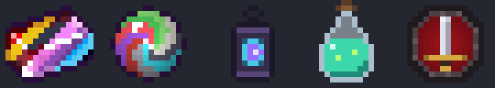

Todos na **bancada** (ou no `/forjaabismo`):

| Item | Para que serve | Receita |
| --- | --- | --- |
| Liga Abissal | traje na bancada | 1 lingote de cada um dos 7 minérios do Abismo |
| Fragmento do Terror | Núcleo Espectral | Essências do Caçador, Carrasco, Encapuzado, Palhaço e Predador |
| Fragmento dos Mortos | Núcleo Espectral | Essências do Zumbi e do Esqueleto Instável, Wither, Servo e Cavaleiro Sombrio |
| Núcleo Espectral | traje na bancada | Fragmento do Terror em cima do Fragmento dos Mortos |
| Lanterna Abissal | na mão secundária, a sanidade cai bem mais devagar | 4 lingotes de Cristal do Eco, 2 de Alma Errante, 2 Essências do Encapuzado e 1 Lanterna das Almas no meio |
| Tônico da Lucidez (faz 2) | clique direito: +50 de sanidade e visão no escuro | Bagas Brilhantes, 2 Fragmentos de Ametista, Essência do Palhaço e Frasco de Vidro |
| Selo do Cavaleiro | clique direito no Abismo: chama o Cavaleiro Sombrio | 4 Essências Wither, 2 lingotes de Hematita, 2 Corações do Abismo e 1 Bloco de Netherite no meio |

> Atenção: o Selo não funciona se o Cavaleiro já estiver vivo, e há uma espera de 20 minutos entre um selo e outro.

## Comandos

- `/forjaabismo`: abre a Forja do Abismo (armaduras, espadas, traje e itens do Abismo).
- `/guia abismo`: o guia do Abismo dentro do jogo.
