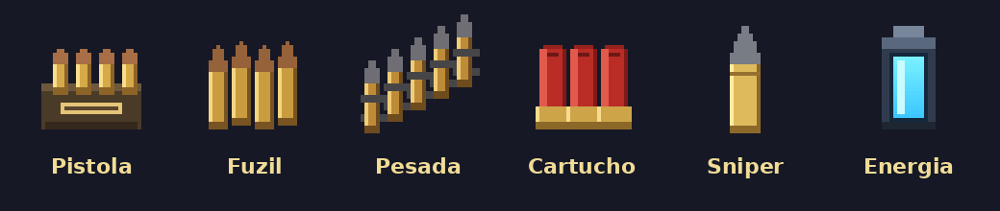
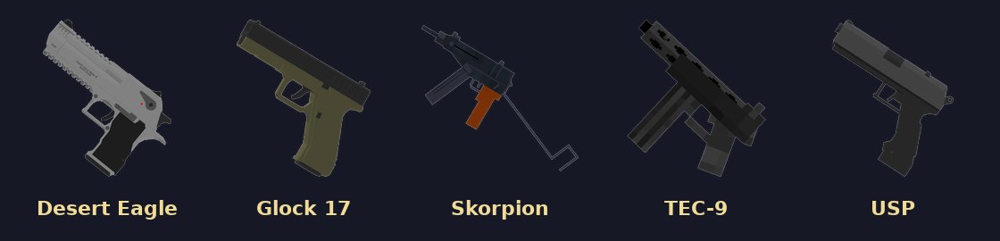
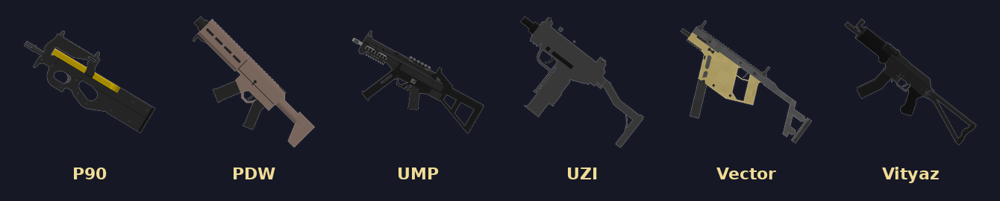
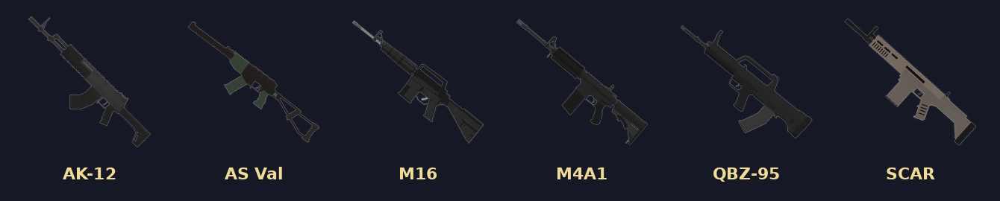
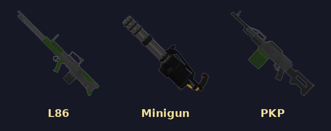
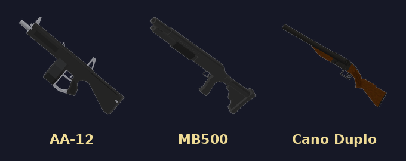
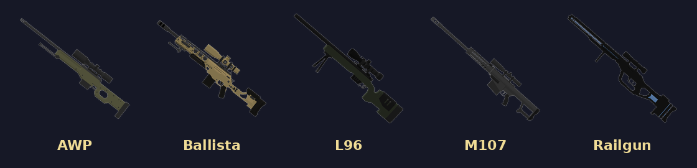

# Armas de Fogo

28 armas com **modelo 3D** (no Java e no Bedrock): pistolas, submetralhadoras, fuzis, metralhadoras, escopetas e snipers. Cada uma usa um tipo de munição e pode ganhar encantamentos próprios.

<!-- capa: midia/armas/capa.png -->
<!-- busca: armas, arma, supply drop, drop, paraquedas, bancada de armeiro, armeiro, planta azul, peças, pecas, traje militar, kevlar, guns, tiro, atirar, munição, municao, bala, pistola, fuzil, sniper, escopeta, metralhadora, minigun, railgun, ak, awp, municao maxima, tiro preciso, recarregar, mira -->

> Para ter uma arma: monte na **Bancada de Armeiro** com a **Planta Azul** e as peças, ou tenha muita sorte num **Supply Drop**.

## Supply Drop

De tempo em tempo (30 a 60 min) uma caixa militar **cai do céu de paraquedas** perto de um jogador, e o chat avisa as coordenadas. A caixa solta fumaça para ser achada e **quem abrir primeiro leva**.

Dentro vem munição, comida, materiais, **peças de arma**, às vezes **Plantas Azuis** e partes do **Traje Militar**. Muito raramente vem uma **arma pronta**. A caixa some depois de 10 minutos ou quando esvazia.

## Bancada de Armeiro

Craft na mesa de trabalho: **ferro** em volta, **bigorna** em cima e **mesa de ferraria** no meio.

| | | |
|---|---|---|
| Ferro | Bigorna | Ferro |
| Ferro | Mesa de ferraria | Ferro |
| Ferro | Ferro | Ferro |

Coloque no chão. Para montar uma arma, clique na bancada **segurando a Planta Azul**: ela fica em cima da mesa. Depois clique de novo na bancada e escolha a arma (a planta é gasta). Para tirar a planta da mesa: **agachado + clique com a mão vazia**. Peças de cada tipo de arma:

| Tipo | Peças |
|---|---|
| Pistola | Cano Curto, Mecanismo, Gatilho, Mola |
| Submetralhadora | Cano Curto, Mecanismo, Gatilho, Mola, Carregador |
| Fuzil | Cano Longo, 2 Mecanismos, Gatilho, Coronha, Carregador |
| Metralhadora | 2 Canos Longos, 3 Mecanismos, Gatilho, Coronha, 2 Carregadores |
| Escopeta | Cano Longo, Mecanismo, Gatilho, Coronha, 2 Molas |
| Sniper | Cano de Precisão, 2 Mecanismos, Gatilho, Coronha, Luneta |

Algumas armas fortes (Desert Eagle, SCAR, Minigun, M107, Railgun, AA-12) pedem peças a mais. A bancada mostra o que falta em cada uma.

Peças e plantas vêm do **Supply Drop** e dos **baús de estrutura**.

## Traje Militar

Capacete, colete, calça e botas com camuflagem, no nível do **Netherite Vermelho**. Monte na Bancada de Armeiro com **Placas de Kevlar** e **Tecido Militar**, ou ache pronto no Supply Drop (raro).

| Parte | Kevlar | Tecido |
|---|---|---|
| Capacete | 5 | 3 |
| Colete | 8 | 5 |
| Calça | 7 | 4 |
| Botas | 4 | 2 |

## Como atirar

| | Java | Bedrock |
|---|---|---|
| Atirar | Clique **direito** (segure nas automáticas) | **Toque** / clique (nas automáticas cada toque solta uma rajada) |
| Mirar | **Agachar** (mais precisão; snipers dão zoom) | **Agachar** (a arma vai para o centro da tela) |
| Recarregar | **Q** ou **F** | **Agachar 2x rápido** |
| Largar a arma | Agachado + **Q** | Normal |

A arma também **recarrega sozinha** quando o pente acaba. A barra em cima da hotbar mostra as balas no pente, o máximo e a reserva que você tem no inventário.

> **Armas desativadas:** em eventos ou manutenção, a staff pode desativar as armas. Aí, ao tentar atirar, aparece **"As armas estão desativadas pelo administrador"**, e a Bancada de Armeiro também pode ficar bloqueada, com o aviso **"A montagem de armas está desativada pelo administrador"**. É só esperar a staff ativar de novo.

## Munição

- **1 item = 1 bala.** Na recarga a arma puxa a munição do seu inventário.
- **Pistola**: pistolas e submetralhadoras · **Fuzil** · **Pesada**: metralhadoras · **Cartucho**: escopetas · **Sniper** · **Célula de Energia**: Railgun.

## Dano

- Tiro na **cabeça** dá **x1,5**.
- Depois da **metade do alcance** o dano vai caindo.
- **Escopetas** soltam vários chumbos de uma vez; a **Railgun** atravessa vários alvos.
- O tiro **não acerta gente da sua guilda** e respeita o PvP de cada lugar. No lobby as armas não atiram.

## Encantamentos

| Encantamento | Raridade | Efeito |
|---|---|---|
| **Munição Máxima** I a III | Épico | +25% de balas no pente por nível (III = +75%) |
| **Tiro Preciso** I a V | Lendário | +8% de dano em cada tiro que acerta, por nível (V = +40%) |

Arraste o livro em cima da arma no inventário. Para subir de nível, use um livro do **mesmo nível** (II + II = III). Esses livros só funcionam em arma de fogo.

## As armas

### Pistolas

| Arma | Dano | Pente | Tiros/s | Alcance | Tipo |
|---|---|---|---|---|---|
| **Desert Eagle** | 11 | 7 | 2 | 55 blocos | Semiautomática |
| **Glock 17** | 5 | 17 | 4 | 40 blocos | Semiautomática |
| **Skorpion** | 3,5 | 20 | 10 | 30 blocos | Automática |
| **TEC-9** | 4 | 24 | 6,7 | 35 blocos | Automática |
| **USP** | 6 | 12 | 3,3 | 45 blocos | Semiautomática |

### Submetralhadoras

| Arma | Dano | Pente | Tiros/s | Alcance | Tipo |
|---|---|---|---|---|---|
| **P90** | 4 | 50 | 10 | 40 blocos | Automática |
| **PDW** | 4 | 30 | 10 | 40 blocos | Automática |
| **UMP** | 5 | 25 | 6,7 | 45 blocos | Automática |
| **UZI** | 3,5 | 32 | 10 | 30 blocos | Automática |
| **Vector** | 4 | 25 | 20 | 35 blocos | Automática |
| **Vityaz** | 4,5 | 30 | 10 | 45 blocos | Automática |

### Fuzis

| Arma | Dano | Pente | Tiros/s | Alcance | Tipo |
|---|---|---|---|---|---|
| **AK-12** | 7 | 30 | 6,7 | 70 blocos | Automática |
| **AS Val** | 6 | 20 | 10 | 55 blocos | Automática (silenciosa) |
| **M16** | 6,5 | 30 | 3,3 | 75 blocos | Rajada de 3 |
| **M4A1** | 6,5 | 30 | 6,7 | 70 blocos | Automática |
| **QBZ-95** | 6,5 | 30 | 6,7 | 70 blocos | Automática |
| **SCAR** | 8 | 20 | 5 | 75 blocos | Automática |

### Metralhadoras

| Arma | Dano | Pente | Tiros/s | Alcance | Tipo |
|---|---|---|---|---|---|
| **L86** | 6,5 | 60 | 6,7 | 80 blocos | Automática |
| **Minigun** | 4 | 200 | 20 | 60 blocos | Automática (aquece 0,8 s) |
| **PKP** | 7 | 100 | 10 | 80 blocos | Automática |

### Escopetas

| Arma | Dano | Pente | Tiros/s | Alcance | Tipo |
|---|---|---|---|---|---|
| **AA-12** | 3 x6 | 20 | 4 | 20 blocos | Automática |
| **MB500** | 3,5 x8 | 6 | 1,1 | 22 blocos | Semiautomática |
| **Cano Duplo** | 4,5 x8 | 2 | 2,5 | 18 blocos | Semiautomática |

### Snipers

| Arma | Dano | Pente | Tiros/s | Alcance | Tipo |
|---|---|---|---|---|---|
| **AWP** | 28 | 5 | 0,7 | 150 blocos | Semiautomática |
| **Ballista** | 22 | 6 | 0,9 | 130 blocos | Semiautomática |
| **L96** | 25 | 5 | 0,8 | 140 blocos | Semiautomática |
| **M107** | 35 | 8 | 0,5 | 160 blocos | Semiautomática |
| **Railgun** | 40 | 3 | 0,4 | 120 blocos | Semiautomática (atravessa 5) |
