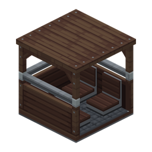

# Elevador de Mina

Um elevador com **cabine 3D** que liga o topo da sua mina às paradas e ao fundo. Quem estiver dentro da cabine viaja junto.

<!-- capa: midia/elevador/elevador.png -->
<!-- busca: elevador, elevadores, mina, cabine, descer, subir, fundo, parada, topo -->

## Como usar

1. Clique com o **botão direito** na **alavanca** do elevador (ou no portão).
2. A cabine chega atrás do portão e ele abre. **Entre na cabine** antes de fechar.
3. A cabine desce (ou sobe), a tela escurece e você chega no destino.

- Com **mais de 2 estações**, aparece um menu para escolher: **Topo**, **Paradas** ou **Fundo**.
- Durante a viagem você não sai da cabine e não toma dano de queda.
- Se o elevador estiver em uso, espere ele voltar.

## Colocar o seu

Com o item **Elevador de Mina**:

1. Clique com o botão direito no chão onde vai ficar o **topo**. O portão fica virado para você e a cabine aparece atrás dele.
2. Desça até onde ele vai parar, **olhe para o chão** e use `/elevador fundo`.
3. Quer paradas no meio? Olhe para o chão e use `/elevador parada` (até 6 estações no total).

> A cabine ocupa **3x3 blocos** e **3 de altura** atrás do portão: deixe esse espaço livre em todas as estações.

## Comandos

| Comando | O que faz |
|---|---|
| `/elevador fundo` | Marca onde o elevador para lá embaixo (olhando para o chão) |
| `/elevador parada` | Marca uma parada no meio |
| `/elevador info` | Mostra as estações do elevador perto de você |
| `/elevador remover` | Tira o elevador (perto dele) e devolve o item |
