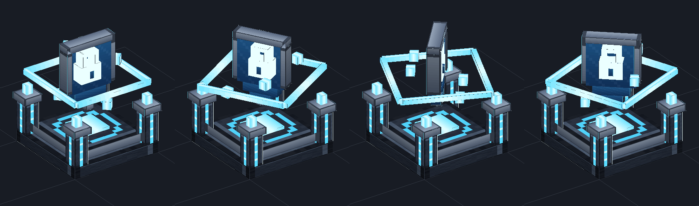

# Proteção de Terreno

Proteja sua casa com o **Núcleo de Proteção**: um escudo com cadeado que gira em cima de um pedestal. Dentro da área, só você e seus membros mexem em tudo.

<!-- oculta -->
<!-- capa: midia/protecao/nucleo.png -->
<!-- busca: protecao, proteção, terreno, claim, nucleo, núcleo, beacon, bloco de protecao, membros, confiar, bloquear, regras, flags, pvp, nivel, spawn, renascer, cp, prot -->

## Como proteger

- Todo jogador ganha um **Bloco de Proteção** na primeira vez que entra no servidor.
- Coloque no chão, no mundo principal. No lugar dele aparece o **Núcleo de Proteção**.
- A área é um quadrado em volta do Núcleo, **do fundo do mundo até o céu**.
- Cada jogador tem **1 proteção**, e ela não pode encostar na de outro jogador.
- O Núcleo não quebra. Clique com o **botão direito** nele (ou use `/protecao`) para abrir o menu.
- Para tirar: menu → **Remover proteção**. O bloco volta para você no mesmo nível.

## Membros e bloqueados

- **Membros** fazem tudo dentro da sua proteção (até 8): menu → Membros, ou `/protecao confiar <nick>`.
- **Bloqueados** não entram, nem andando nem por `/tpa`: menu → Bloqueados, ou `/protecao bloquear <nick>`.
- `/protecao sair` tira você de uma proteção onde é membro.

## Regras

No menu → **Regras**, você liga ou desliga:

| Regra | O que faz |
|---|---|
| PvP | Jogadores se atacam aqui dentro |
| Fogo | Fogo espalha e queima blocos |
| Monstros nascem | Monstros aparecem sozinhos |
| Explosões | Creeper, TNT etc. quebram blocos |
| Mobs quebram | Enderman, zumbi na porta etc. |
| Visitantes constroem | Quem não é membro coloca blocos |
| Visitantes quebram | Quem não é membro quebra blocos |
| Plantas crescem | Plantações, árvores e trepadeiras |
| Visitantes usam | Baús, portas, fornalhas etc. |
| Visitantes usam redstone | Botões, alavancas e placas de pressão |

As regras de visitante não valem para você nem para os seus membros.

## Níveis

Menu → **Nível**. Cada nível aumenta a área:

| Nível | Área | Preço |
|---|---|---|
| 1 | 31x31 | grátis |
| 2 | 61x61 | $25.000 |
| 3 | 91x91 | $50.000 |
| 4 | 121x121 | $125.000 |
| 5 | 131x131 | $312.500 |
| 6 | 161x161 | $562.500 |

Descer de nível devolve **metade** do preço do nível em que você está.

## Spawn e renascer

- Menu → **Marcar spawn aqui** (dentro da sua proteção). `/protecao spawn` leva até lá: fique parado 5 segundos.
- Morreu? Você renasce na sua **cama**. Sem cama, no **spawn da sua proteção**.
- Membro **não** renasce na proteção dos outros, só na própria.
- `/protecao ver` mostra a borda: **verde** = sua, **azul** = você é membro, **vermelho** = de outro jogador.

## Comandos

| Comando | O que faz |
|---|---|
| `/protecao` | Abre o menu (o mesmo do clique no Núcleo) |
| `/protecao confiar <nick>` / `desconfiar <nick>` | Adiciona / tira membro |
| `/protecao bloquear <nick>` / `desbloquear <nick>` | Bloqueia / desbloqueia |
| `/protecao melhorar` / `rebaixar` | Sobe / desce de nível |
| `/protecao spawn` | Vai para o spawn da proteção |
| `/protecao definirspawn` | Marca o spawn onde você está |
| `/protecao ver` | Mostra / esconde a borda |
| `/protecao info` | De quem é a proteção onde você está |
| `/protecao sair` | Sai de uma proteção onde você é membro |

Também funciona com `/prot` e `/cp`.
