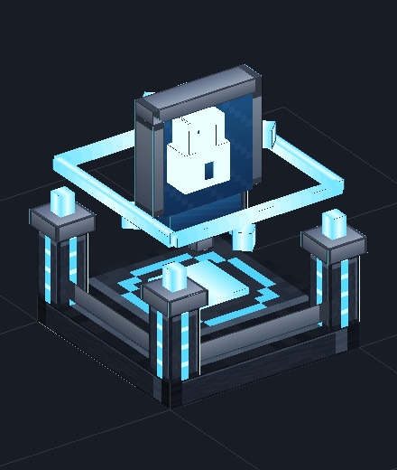
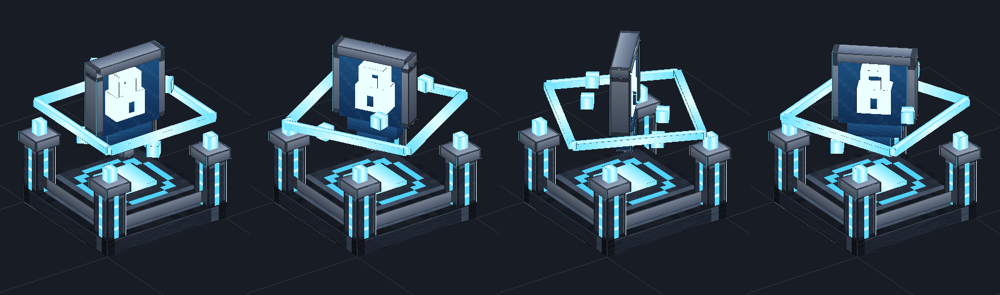
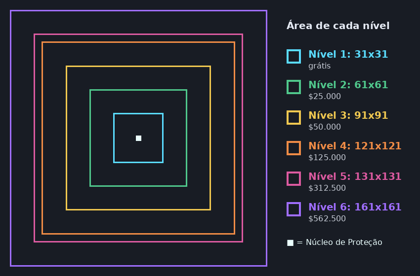
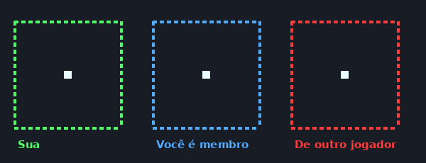

# Proteção de Terreno

Proteja sua casa com o **Núcleo de Proteção**: um escudo com cadeado que gira em cima de um pedestal. Dentro da área, só você e seus membros mexem em tudo.

<!-- oculta -->
<!-- capa: midia/protecao/nucleo-girando.png -->
<!-- busca: protecao, proteção, terreno, claim, nucleo, núcleo, beacon, bloco de protecao, membros, confiar, bloquear, regras, flags, pvp, nivel, spawn, renascer, cp, prot, qg, efeitos, voo, xp, expansao, expansão, beaconplus, matança, spawner -->

## Como proteger

- Todo jogador ganha um **Bloco de Proteção** na primeira vez que entra no servidor.
- Coloque no chão, no mundo principal. No lugar dele aparece o **Núcleo de Proteção**.
- A área é um quadrado em volta do Núcleo, **do fundo do mundo até o céu**.
- Cada jogador tem **1 proteção**, e ela não pode encostar na de outro jogador.
- O Núcleo não quebra. Clique com o **botão direito** nele (ou use `/protecao`) para abrir o menu.
- Para tirar: menu → **Remover proteção**. O bloco volta para você no mesmo nível. Precisa ter **um espaço livre no inventário**; com o inventário cheio, não deixa recolher.
- O Bloco de Proteção **fica sempre com você**: não pode ser largado, não cai ao morrer e não entra em baú, shulker, cofre, mochila, pacote nem moldura.

> Dica: as imagens são uma prévia do modelo, fora do jogo.

## Membros e bloqueados

- **Membros** fazem tudo dentro da sua proteção (até 8): menu → Membros, ou `/protecao confiar <nick>`.
- **Bloqueados** não entram, nem andando nem por `/tpa`: menu → Bloqueados, ou `/protecao bloquear <nick>`.
- `/protecao sair` tira você de uma proteção onde é membro.

## Regras

No menu → **Regras**, você liga ou desliga:

| Regra | O que faz |
|---|---|
| PvP | Jogadores se atacam aqui dentro |
| Fogo | Fogo espalha e queima blocos |
| Monstros nascem | Monstros aparecem sozinhos |
| Explosões | Creeper, TNT etc. quebram blocos |
| Mobs quebram | Enderman, zumbi na porta etc. |
| Visitantes constroem | Quem não é membro coloca blocos |
| Visitantes quebram | Quem não é membro quebra blocos |
| Plantas crescem | Plantações, árvores e trepadeiras |
| Visitantes usam | Baús, portas, fornalhas etc. |
| Visitantes usam redstone | Botões, alavancas e placas de pressão |

As regras de visitante não valem para você nem para os seus membros.

## QG do Núcleo

O Núcleo tem um **nível de QG** (do 1 ao 50). É o nível principal: ele libera os tamanhos da expansão e os níveis dos efeitos.

- O Núcleo junta **XP** de tudo que você e seus membros fazem dentro da área: minerar, construir, colher, matar mobs (até os de spawner), encantar, craftar, tirar itens da fornalha, cruzar animais e pescar.
- Menu → **QG**: gaste a XP para **subir o QG** ou **saque** como XP de verdade para você (2 pontos do Núcleo = 1 de XP).
- Bloco que você mesmo colocou há pouco não dá XP de novo ao quebrar.
- O QG também decide **quantos spawners** você junta numa pilha (veja a página **Spawners**).

## Expansão

Menu → **Expansão**. Não custa dinheiro: cada tamanho pede um nível de QG.

| Nível | Área | Precisa do |
|---|---|---|
| 1 | 31x31 | — |
| 2 | 61x61 | QG 5 |
| 3 | 91x91 | QG 12 |
| 4 | 121x121 | QG 20 |
| 5 | 131x131 | QG 30 |
| 6 | 161x161 | QG 40 |

Diminuir a área não devolve nada; para crescer de novo é só ter o QG.

## Efeitos do Núcleo

Menu → **Efeitos**. O menu tem abas: **Jogador**, **Monstros**, **Área** e **Produção**. Cada efeito mostra uma barra de nível, e os que estão ligados brilham. O dono compra cada nível com dinheiro, e cada nível pede um QG mínimo. Todo efeito liga e desliga sem perder o nível, e ao tirar o Núcleo o bloco guarda o QG, a XP e os efeitos.

**Para você e os membros, dentro da área:**

| Efeito | Níveis |
|---|---|
| Velocidade, Super Pulo, Força, Resistência, Mineração Rápida, Sorte | I a III |
| Regeneração, Invisibilidade | I e II |
| Voo (até 10/20/30/40 blocos acima do Núcleo) | I a IV |
| Visão Noturna, Respiração na Água, Extintor (apaga o fogo) | I |
| Cura (tira efeitos ruins), Saturação (enche a fome), Auto Reparo | I a III |
| Redução de Recarga (pérola, escudo, maçã...) | I a III (até -75%) |
| XP Extra | I a V (até x1,9) |

**Contra monstros:** Veneno (menos nos mortos-vivos), Lentidão, Queimar Mortos-vivos e Brilho (contorno nos monstros e em quem não é membro).

**Na área:** Gravidade (puxa monstros, itens ou animais para o Núcleo), Área Pacífica (monstros não atacam; no II nem nascem) e Alcance Extra (os efeitos vão até 20 blocos além da borda).

**Produção:** Plantações Rápidas (I a VI), Fornalha Rápida (até 75%), Spawner Rápido (até 50%) e **Modo Matança**: mob que sai de spawner na área toma dano até morrer e dá XP para o Núcleo.

## Spawn e renascer

- Menu → **Marcar spawn aqui** (dentro da sua proteção). `/protecao spawn` leva até lá: fique parado 5 segundos.
- Morreu? Você renasce na sua **cama**. Sem cama, no **spawn da sua proteção**.
- Membro **não** renasce na proteção dos outros, só na própria.
- `/protecao ver` mostra a borda: **verde** = sua, **azul** = você é membro, **vermelho** = de outro jogador.

## Comandos

| Comando | O que faz |
|---|---|
| `/protecao` | Abre o menu (o mesmo do clique no Núcleo) |
| `/protecao confiar <nick>` / `desconfiar <nick>` | Adiciona / tira membro |
| `/protecao bloquear <nick>` / `desbloquear <nick>` | Bloqueia / desbloqueia |
| `/protecao melhorar` / `rebaixar` | Aumenta / diminui a área (precisa do QG) |
| `/protecao efeitos` | Efeitos do Núcleo |
| `/protecao qg` | Nível do QG e XP do Núcleo |
| `/protecao spawn` | Vai para o spawn da proteção |
| `/protecao definirspawn` | Marca o spawn onde você está |
| `/protecao ver` | Mostra / esconde a borda |
| `/protecao info` | De quem é a proteção onde você está |
| `/protecao sair` | Sai de uma proteção onde você é membro |

Também funciona com `/prot` e `/cp`.
