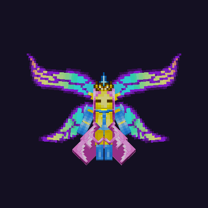
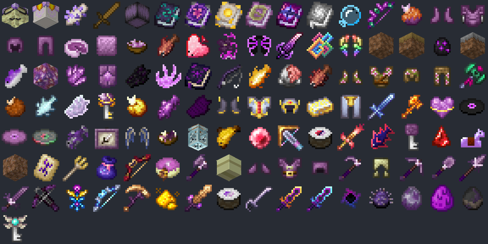
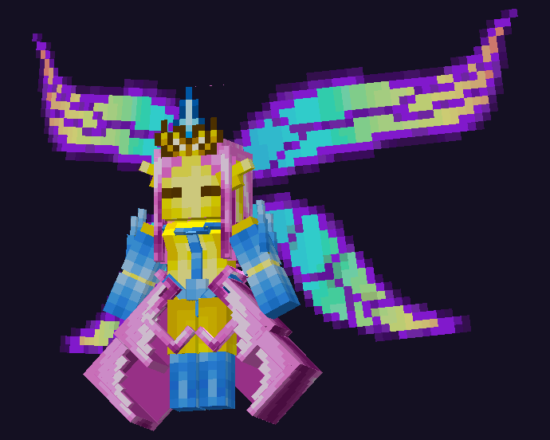
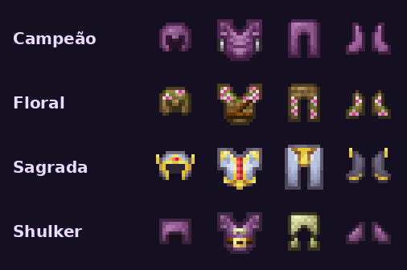

# End Renovado (Stellarity)

O End mudou: ilhas gigantes, biomas novos, chefes mais fortes, dois altares e dezenas de armas, armaduras e asas novas. A estrela é a **Imperatriz da Luz**, uma chefe que pode virar seu pet.

<!-- oculta -->
<!-- capa: midia/stellarity/imperatriz.png -->
<!-- busca: stellarity, nullscape, end, the end, imperatriz, imperatriz da luz, empress, empress of light, dragao, dragão, altar, altar of the accursed, altar dos sagrados, ferrugem estelar, starlight soot, asas, elitro, élitro, enderite, deus, orbe divino -->

## O que mudou no End

- O terreno é novo: ilhas gigantes, biomas e estruturas que não existiam antes.
- Os itens novos saem dos **chefes**, dos **baús das estruturas**, da **pesca no Vazio** e do **Altar of The Accursed**.
- Tudo aparece com textura própria no **Java e no Bedrock**.

## Dragão do Ender

- O Dragão ganhou ataques novos, música e uma barra de chefe própria.
- Derrotar o Dragão destrava o **Altar of The Accursed** na ilha principal.

## Altar of The Accursed

- É a bancada sombria do End: jogue os itens no chão, em cima do altar, para criar o equipamento mais forte do End.
- Jogar um **livro encantado** em cima dele imbui o livro com magia sombria.
- Ele só funciona depois que o Dragão é derrotado.

## Altar dos Sagrados

- Pode ser colocado em qualquer lugar. Jogue minérios em cima dele para ganhar bônus que duram bastante.
- Jogue **Ferrugem Estelar** em cima dele para chamar a **Imperatriz da Luz**.
- A Ferrugem Estelar vem das Pixies, dos baús dos navios das End Cities e da pesca no Vazio.

## Imperatriz da Luz

- Chefe de luz com raios prismáticos, lanças etéreas e investidas. De dia e de noite ela tem visual e ataques diferentes.
- No Bedrock ela aparece com modelo 3D e asas batendo.
- Ela é **Deus** na Captura: só o **Orbe Divino** pega. Capturada, vira um pet com estas habilidades:

| Nível | Habilidade | O que faz |
|---|---|---|
| 1 | Graça da Imperatriz | Regeneração I e Velocidade I no dono o tempo todo (não ocupa vaga) |
| 25 | Raios Prismáticos | Raio de luz a cada 6s: 2,2x o dano e Brilho |
| 50 | Lanças Etéreas | A cada 20s: 2,5x o dano e Levitação nos inimigos a 6 blocos |
| 75 | Aurora Radiante | A cada 40s cura 5 corações do dono e de quem estiver perto, e 30% da vida dos pets |

> Dica: as imagens são uma prévia do modelo, fora do jogo.

## Livros mágicos

- **Livro da Luz, Livro de Ventania, Livro do Azar, Conveyance, Obstruct e Return**: clique direito para lançar a magia.
- Cada magia gasta **mana** do Skills: Ventania 20 · Conveyance 25 · Azar 30 · Obstruct 30 · Return 40 · Luz 50.
- Sem mana a magia não sai. Livro em recarga não gasta nada.

## Armaduras e asas

- Quatro conjuntos novos: **Campeão, Floral, Sagrada e Shulker**. No Bedrock eles aparecem vestidos também.
- **Asas do Dragão, da Imperatriz e de Phantom** funcionam como élitros, cada uma com seu jeito de voar. No Bedrock elas aparecem e voam como élitros comuns.
