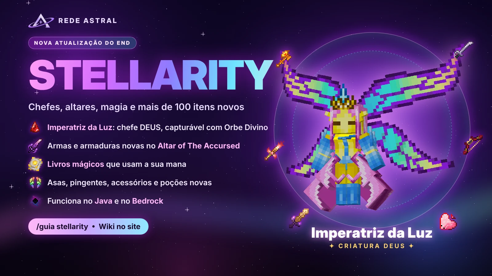
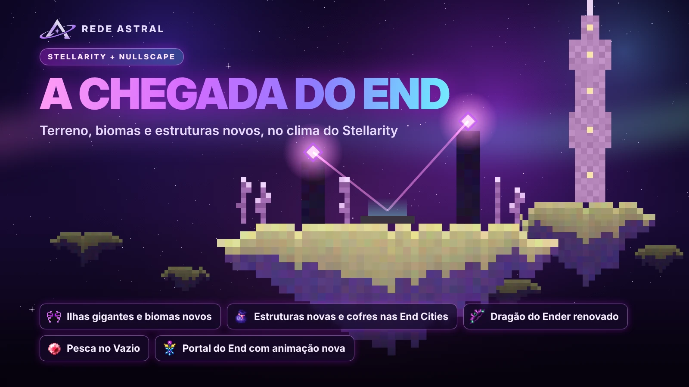
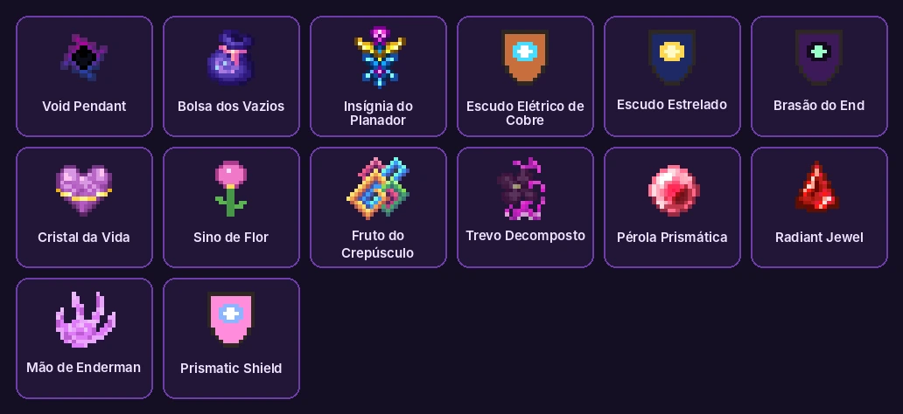
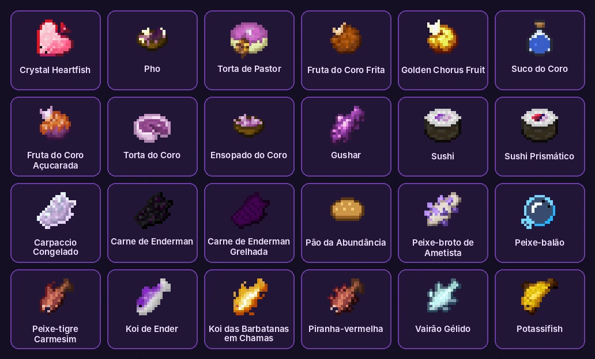
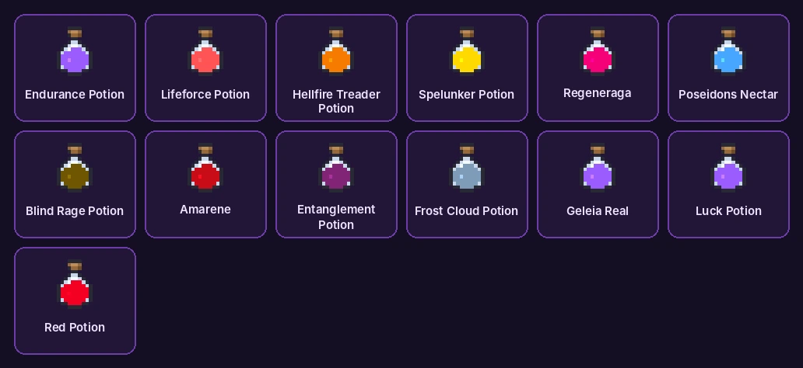
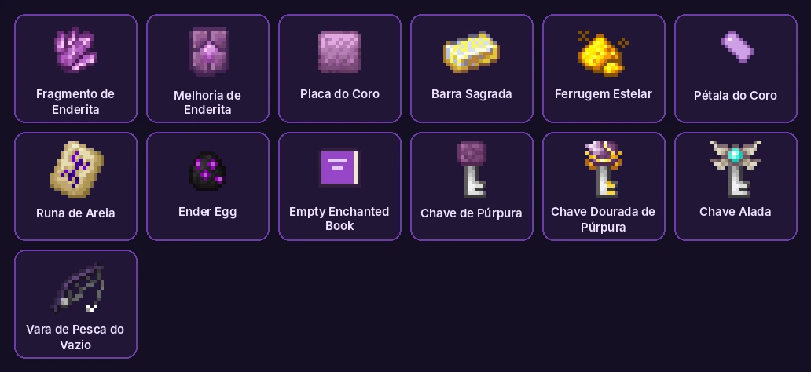

# End Renovado (Stellarity)

O End mudou: ilhas gigantes, biomas novos, chefes mais fortes, dois altares e dezenas de armas, armaduras e asas novas. A estrela é a **Imperatriz da Luz**, uma chefe que pode virar seu pet.

<!-- capa: midia/stellarity/anuncio-stellarity.webp -->
<!-- busca: pingente, void pendant, insignia, bolsa dos vazios, cristal da vida, pocoes, poções, comidas, chaves, enderita, stellarity, nullscape, end, the end, imperatriz, imperatriz da luz, empress, empress of light, dragao, dragão, altar, altar of the accursed, altar dos sagrados, ferrugem estelar, starlight soot, asas, elitro, élitro, enderite, deus, orbe divino -->

## O que mudou no End

- O terreno é novo: ilhas gigantes, biomas e estruturas que não existiam antes.
- Os itens novos saem dos **chefes**, dos **baús das estruturas**, da **pesca no Vazio** e do **Altar of The Accursed**.
- Tudo aparece com textura própria no **Java e no Bedrock**.

## Dragão do Ender

- O Dragão ganhou ataques novos, música e uma barra de chefe própria.
- Derrotar o Dragão destrava o **Altar of The Accursed** na ilha principal.

## Altar of The Accursed

- É a bancada sombria do End: jogue os itens no chão, em cima do altar, para criar o equipamento mais forte do End.
- Jogar um **livro encantado** em cima dele imbui o livro com magia sombria.
- Ele só funciona depois que o Dragão é derrotado.

## Altar dos Sagrados

- Pode ser colocado em qualquer lugar. Jogue minérios em cima dele para ganhar bônus que duram bastante.
- Jogue **Ferrugem Estelar** em cima dele para chamar a **Imperatriz da Luz**.
- A Ferrugem Estelar vem das Pixies, dos baús dos navios das End Cities e da pesca no Vazio.

## Imperatriz da Luz

- Chefe de luz com raios prismáticos, lanças etéreas e investidas. De dia e de noite ela tem visual e ataques diferentes.
- No Bedrock ela aparece com modelo 3D e asas batendo.
- Ela é **Deus** na Captura: só o **Orbe Divino** pega. Capturada, vira um pet com estas habilidades:

| Nível | Habilidade | O que faz |
|---|---|---|
| 1 | Graça da Imperatriz | Regeneração I e Velocidade I no dono o tempo todo (não ocupa vaga) |
| 25 | Raios Prismáticos | Raio de luz a cada 6s: 2,2x o dano e Brilho |
| 50 | Lanças Etéreas | A cada 20s: 2,5x o dano e Levitação nos inimigos a 6 blocos |
| 75 | Aurora Radiante | A cada 40s cura 5 corações do dono e de quem estiver perto, e 30% da vida dos pets |

> Dica: as imagens são uma prévia do modelo, fora do jogo.

## Livros mágicos

- **Livro da Luz, Livro de Ventania, Livro do Azar, Conveyance, Obstruct e Return**: clique direito para lançar a magia.
- Cada magia gasta **mana** do Skills: Ventania 20 · Conveyance 25 · Azar 30 · Obstruct 30 · Return 40 · Luz 50.
- Sem mana a magia não sai. Livro em recarga não gasta nada.

## Armaduras e asas

- Quatro conjuntos novos: **Campeão, Floral, Sagrada e Shulker**. No Bedrock eles aparecem vestidos também.
- **Asas do Dragão, da Imperatriz e de Phantom** funcionam como élitros, cada uma com seu jeito de voar. No Bedrock elas aparecem e voam como élitros comuns.

## Acessórios

Funcionam na mão ou no inventário.

- **Pingente do Vazio (Void Pendant)**: recebe uma gema no Altar of The Accursed (precisa de 1 Fragmento de Enderita). Cada gema dá um bônus:

| Gema | Bônus | Efeito |
|---|---|---|
| Ametista | Visão | Visão noturna e inimigos brilham quando você agacha |
| Cobre | Poder | Ataques às vezes soltam um raio elétrico extra |
| Diamante | Fúria | +6% de velocidade de ataque |
| Esmeralda | Fortuna | +1 de sorte |
| Ouro | Espeleologia | +15% de velocidade de mineração |
| Ferro | Fortitude | -12% de dano recebido |
| Lápis | Sabedoria | +1 a 3 de XP em tudo |
| Netherite | Fúria (Rage) | +2 de dano e +35% de dano em varredura |
| Quartzo | Agilidade | +4% de velocidade e de pulo |

- **Bolsa dos Vazios**: abre o Altar of The Accursed de qualquer lugar. Numa moldura na parede, vira um altar seu, permanente.
- **Insígnia do Planador**: voo infinito, mas lento. Agache olhando para cima ou para baixo para subir ou descer.
- **Escudo Elétrico de Cobre**: agachar dá uma investida elétrica (até 3 cargas a cada 8s).
- **Escudo Estrelado**: quando você bloqueia, caem estrelas.
- **Brasão do End**: bloquear deixa o próximo ataque mais forte.
- **Cristal da Vida**: parado, a vida volta rápido.
- **Sino de Flor**: segurando, mostra as criaturas por perto.
- **Fruto do Crepúsculo**: no inventário dá velocidade, visão e força. Comer ou plantar tem consequências ruins.
- **Trevo Decomposto**: melhora o loot e a sorte na pesca do Vazio.
- **Pérola Prismática**: pérola do Ender infinita, com recarga de 5s.
- **Joia Radiante**: na mão, melhora as armas prismáticas (a Pérola recarrega em 2,5s e o Kaleidoscope carrega mais rápido).

## Comidas

- **Peixe-coração de Cristal**: +1 de vida máxima para sempre (até +5 corações).
- **Pho** e **Torta de Pastor**: enchem quase toda a fome e dão efeitos.
- **Fruta do Coro Frita** e **Fruta do Coro Dourada**: teleportam você para perto, como o coro.
- **Suco do Coro**: Velocidade e Pulo.
- **Geleia Real**: Absorção.
- **Gushar**: serve no lugar da bola de slime nas receitas.
- Sushis, peixes novos, carne de Enderman e tortas: comida normal, com efeitos pequenos.

## Poções

| Poção | Efeito |
|---|---|
| Endurance | Resistência por 2 min |
| Lifeforce | Vida extra por 3 min |
| Hellfire Treader | Velocidade e Resistência ao Fogo por 4 min |
| Spelunker | Visão Noturna e Pressa por 3 min |
| Regeneraga | Cura na hora e Regeneração III |
| Poseidon's Nectar | Conduíte, Absorção e Graça do Golfinho por 6,5 min |
| Blind Rage | Força III, mas com Escuridão (15s) |
| Amarene | Velocidade II e Regeneração, mas com Fraqueza |
| Entanglement (arremesso) | Lentidão V nos inimigos |
| Frost Cloud (persistente) | Congela quem fica na nuvem por 6s |

> Cuidado com a **Red Potion**: é uma pegadinha. Escuridão, Lentidão e Cansaço no máximo, para sempre. Só leite tira.

## Materiais e chaves

- **Fragmento de Enderita** e **Melhoria de Enderita**: sobem equipamento de Netherite para Enderita no Altar of The Accursed.
- **Placa do Coro**: reforça armadura de Netherite.
- **Barra Sagrada**: material da armadura Sagrada.
- **Ferrugem Estelar**: chama a Imperatriz. Num caldeirão com água, transforma itens por um tempo.
- **Chave de Púrpura** e **Chave Dourada de Púrpura**: abrem os cofres das End Cities. **Chave Alada**: abre o cofre de élitros dos navios do End.
- **Vara de Pesca do Vazio**: pesca no Vazio um pouco mais rápido.
- **Mapas de explorador**: levam até estruturas do End.

> O **Endonomicon** e os **discos de música** do Stellarity precisam de mod/addon e não funcionam no servidor.
